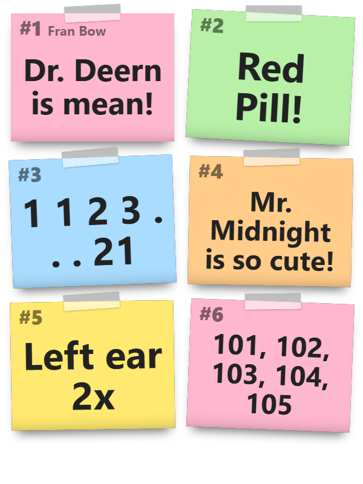
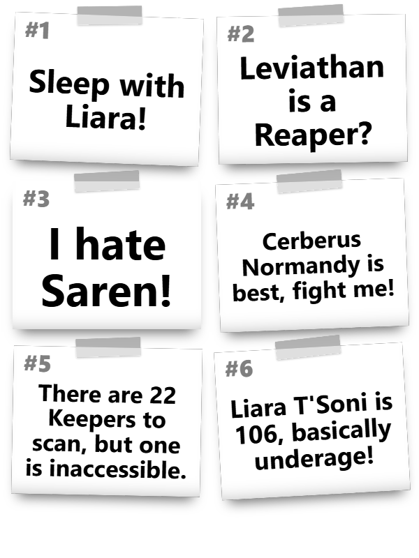

<h1 align="center">OBS Notes</h1>

  <b>Can't remember the code of the padlock? Your chat can add a post-it in OBS.</b> 
  Short notes from chat, one list per game, shown on stream as post-its.

  
  
  
  
  

  
  

---

## 📝 How It Works

A safe code, a quest item, the name of an NPC: viewers write it down with a chat command and it sticks on
stream until somebody wipes it off. Every game (the Twitch category) keeps its own list, so the notes from
yesterday's game come back when you play it again.

| Command | Also | Who | What it does |
|---------|------|-----|--------------|
| `!note <text>` | `!notiz`, `!postit`, `!aufschreim`, `!merkn` | everyone | Saves a note and answers with its number. |
| `!zettel` | `!schmierzettel`, `!merkheftl`, `!shownotes` | everyone | Posts the last five notes in chat; `!zettel 3` posts note 3. |
| `!radier <number>` | `!delnote`, `!deletenote` | Moderators, VIPs | Deletes one note; the ones after it move up. |
| `!clearnotes` | `!allesradiern` | Moderators, VIPs | Deletes every note of the current game. |

The commands work on Twitch, Kick and YouTube, and the answer goes to the chat the command came from, with an
emote of that platform: Twitch and Kick global emotes, plain emoji on YouTube. Untick a source in a command to
leave that platform out. The list always follows the Twitch category; without Twitch every note goes to one list.

Each command has a 5 second cooldown; the broadcaster is never held back. The replies in chat are in German
(partly Bavarian) or English, see `language` below.

---

## 📺 On Stream

A local HTML page that OBS shows as a browser source and that follows the notes within two seconds.

- One post-it per note, its text as large as the post-it allows, so `4711` stays readable even when the source
  is scaled down to a corner of the screen.
- Six post-its fit; when there are more, the oldest make room and a line counts the ones that no longer fit.
- The game name sits on the first post-it, next to its number.
- Without notes, or after a while without commands, nothing is shown at all.

---

## 🚀 Setup

1. Import [Import-String.md](Import-String.md) in Streamer.bot (*Import*, paste the string), or drop
   `OBS-Notes.sb` from the [latest release](https://github.com/aaskjer/OBSNotes/releases/latest) onto the
   import window.
2. Turn on the four commands in the group **OBS Notes** (*Commands* tab). They are imported switched off.
3. Connect OBS in Streamer.bot (*Stream Apps > OBS*). OBS has to run on the same PC, because the browser source
   reads a local file.
4. In the action **OBS Notes**, right-click the trigger **Test** > *Test Trigger*. It adds the browser source
   **OBS Notes** (600 x 800) to the scene OBS is showing. Move and scale it wherever you like.

The Test trigger's variable `AddOBSOverlayTo` names the OBS connection: `0` is the first one in Streamer.bot.
Running the trigger again refreshes the source, or adds it to the scene that is showing now.

---

## ⚙️ Settings

Set Argument sub-actions in the action **OBS Notes**, under *Settings (Important to check!)*.

**Chat**

| Argument | Default | |
|----------|---------|---|
| `useBot` | `True` | Answers from the bot account; `False` = from the broadcaster account. Without a connected bot account Streamer.bot uses the broadcaster account. |
| `sendAsMe` | `False` | `True` = answers as a /me message (Twitch only; Kick and YouTube have none). |
| `language` | `DE` | `DE` (German, partly Bavarian) or `EN` (English), for the chat answers and the post-its. |

**Overlay**

| Argument | Default | |
|----------|---------|---|
| `hideAfterMinutes` | `10` | Minutes without any command until the post-its fade out. The next command brings them back. `0` = always visible. |
| `colorfulNotes` | `True` | `False` = black text on white post-its. |
| `showGameName` | `True` | The game name on the first post-it. |

Changes reach OBS with the next command or Test trigger.

---

## 📁 Files

Everything lives in `OBS Notes` inside the Streamer.bot folder:

- `<Game>-Notes.json`: the notes of one game.
- `<Game>-Notes.json.bak`: every note ever added to that game, one per line, in case one was wiped by mistake.
- `Overlay\notes_overlay.html` and `notes_state.json`: the page OBS shows and what it shows.

---

## Requirements

- Streamer.bot 1.0.7 or newer with Twitch connected (the Twitch category picks the list); Kick and YouTube optional
- OBS Studio 28 or newer (tested with 33), connected in Streamer.bot, on the same PC

## License

[MIT](LICENSE)
