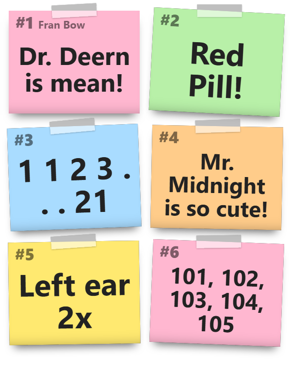
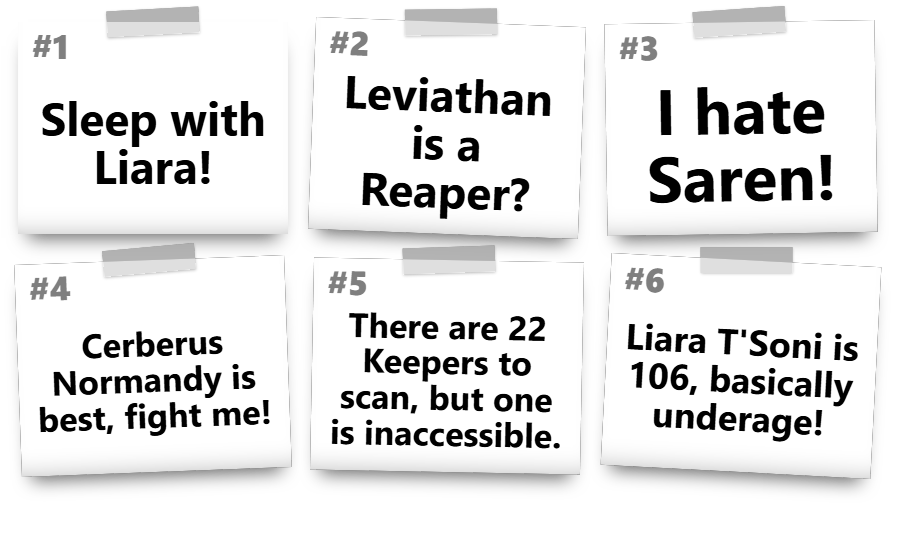

<h1 align="center">OBS Notes</h1>

<p align="center">
  <b>Can't remember the code of the combination lock? Your chat can add a post-it in OBS.</b><br>
  Short notes from chat, one list per game, shown on stream as post-its.
</p>

<p align="center">
  
  
  
  
  
</p>

<p align="center">
  <a href="https://github.com/aaskjer/OBSNotes/releases/latest"><b>Download</b></a> &nbsp;·&nbsp;
  <a href="Setup-Guide.md"><b>Setup Guide</b></a> &nbsp;·&nbsp;
  <a href="FAQ.md"><b>FAQ</b></a> &nbsp;·&nbsp;
  <a href="Import-String.md"><b>Import String</b></a> &nbsp;·&nbsp;
  <a href="https://github.com/aaskjer/OBSNotes/releases"><b>Changelog</b></a>
</p>

<p align="center">
  
  
</p>

---

## 📖 Overview

OBS Notes is a chat tool for Streamer.bot. Viewers write something down with `!note`, and it sticks on stream
as a post-it until a moderator or VIP wipes it off. Every game keeps its own list, so yesterday's notes come back
when you play that game again. After ten minutes without a command the post-its fade out, and the next one brings
them back.

```
NoScopeNick: !note 1 1 2 3 . . . 21
YourBot: Note written down as number '#3'. SeemsGood
LunaLurks: !shownotes 3
YourBot: [3] "1 1 2 3 . . . 21" - written down by @NoScopeNick on [2026-10-27 / 20:18:11]
```

## ✨ Highlights

- 🎮 **One list per game.** The list follows the Twitch category, or the Kick category when Twitch is not
  connected. Without either, all notes share one list.
- 🔍 **Readable at any size.** Each note's text grows as large as its post-it allows, so `4711` stays legible
  even when the source is scaled down to a corner of the screen.
- 📐 **Upright or wide.** Six post-its in three rows of two (600 x 800) or in two rows of three (900 x 560),
  colourful with the game name or black on white.
- 📝 **Post-its that hang like real ones.** Each sits at one of six angles or straight, never quite like the
  one before it, and keeps its angle when OBS reloads the page.
- 🗂️ **Create Piles.** Six post-its fit on the board. The seventh sticks over the first, so older notes peek out
  underneath instead of disappearing.
- 💬 **Twitch, Kick and YouTube.** Replies go to the chat the command came from, with an emote of that
  platform, in German or English.
- 💾 **Nothing lost by mistake.** A backup file per game keeps every note ever added, one per line.
- 🔄 **Updates without touching OBS.** After an import, the first command points browser sources that still
  show an older page to the current one.

---

## Credits

- **Author:** [aaskjer on Twitch](https://twitch.tv/aaskjer) · [aaskjer.github.io](https://aaskjer.github.io/)
- **Built for:** [Streamer.bot](https://streamer.bot) by [nate1280](https://www.patreon.com/c/nate1280/home)
- **Works with:** [OBS Studio](https://obsproject.com) 28 or newer, as a browser source
- **Data & services:** [Kick](https://kick.com): your channel's category, read from its public channel page when
  Twitch is not connected
- **Thanks:** YOU ♡

None of the projects and services above is affiliated with or endorses OBS Notes.
