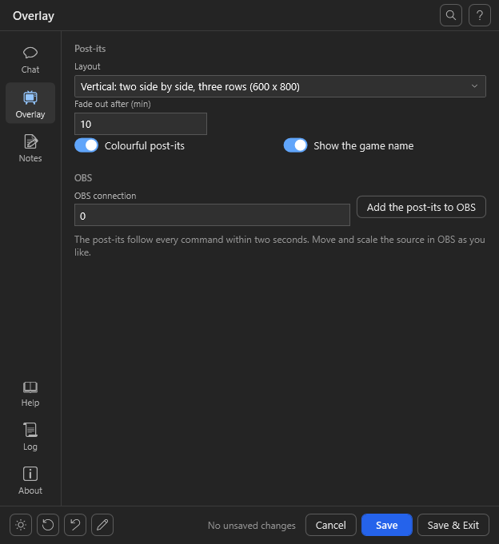
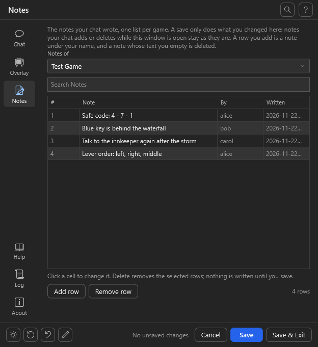

# OBS Notes: Setup Guide

## Commands

| Command | Also | Who | What it does |
|---------|------|-----|--------------|
| `!note <text>` | `!notiz`, `!postit`, `!aufschreiben`, `!merken` | everyone | Saves a note and answers with its number. |
| `!zettel` | `!schmierzettel`, `!merkheft`, `!shownotes` | everyone | Posts the last five notes in chat; `!zettel 3` posts note 3. |
| `!radier <number>` | `!delnote`, `!deletenote` | Moderators, VIPs | Deletes one note; the ones after it move up. |
| `!clearnotes` | `!allesradieren` | Moderators, VIPs | Deletes every note of the current game. |

The commands work on Twitch, Kick and YouTube, and the answer goes to the chat the command came from, with an
emote of that platform: Twitch and Kick global emotes, plain emoji on YouTube. Untick a source in a command to
leave that platform out. The list follows the Twitch category. Without Twitch it follows the Kick category, read from
Kick's public channel page (the live stream's category, offline the latest one); without either, every note goes to
one list.

Each command has a 5 second cooldown; the broadcaster is never held back. The replies in chat are in German
or English, see *Chat answers in* under [Settings](#settings).

---

## Setup

1. Import [Import-String.md](Import-String.md) in Streamer.bot (*Import*, paste the string), or drop
   `OBS-Notes.sb` from the [latest release](https://github.com/aaskjer/OBSNotes/releases/latest) onto the
   import window.
2. Turn on the four commands in the group **OBS Notes** (*Commands* tab). They are imported switched off.
3. Connect OBS in Streamer.bot (*Stream Apps > OBS*). OBS has to run on the same PC, because the browser source
   reads a local file.
4. Open the settings: in the action **OBS Notes Settings**, right-click the trigger **Test** > *Test Trigger*.
   The first time, a dialog asks whether to download `UIFramework.dll`, the window itself. Click `Yes`.
5. On the **Overlay** page, press **Add the post-its to OBS**. It adds the browser source **OBS Notes**
   (600 x 800, or 900 x 560 with the horizontal layout) to the scene OBS is showing. Move and scale it wherever
   you like.

*OBS connection*, next to the button, names the OBS the post-its go to: `0` is the first one in Streamer.bot.
Pressing the button again refreshes the source, or adds it to the scene that is showing now. The box under the
button says what happened. Nothing in OBS? See the [FAQ](FAQ.md#the-post-its-do-not-show-up-in-obs).

The trigger **Test** of the action **OBS Notes** does the same without the window. Its variable `AddOBSOverlayTo`
names the OBS connection; left empty, the one from the window counts.

Updates keep the post-its in OBS: the first command after an import looks in every connected OBS for a browser
source that still shows the page of an older version, points it to the current page and says so in the log.

**Updating from 1.0.x?** Import the new version over the old one. The notes and the post-its in OBS stay. The
settings were `Set Argument` sub-actions of the action **OBS Notes**, which the import replaces: the first time the
window opens, it takes their values from Streamer.bot's own backup of your actions (the folder `backup`) and shows
them as unsaved changes. Look them over and press `Save`. Without such a backup the window opens with the
defaults.

---

## Requirements

- Streamer.bot 1.0.7 or newer with Twitch or Kick connected (its category picks the list, Twitch first); YouTube optional
- OBS Studio 28 or newer (tested with 33), connected in Streamer.bot, on the same PC
- For the settings window: [UIFramework for streamer.bot](https://github.com/aaskjer/UIFramework-Streamer.bot)
  2.5.0 or newer. It is not part of the import: the settings action downloads it the first time the window opens,
  into the folder `UIFramework` inside the Streamer.bot folder, and offers the update when an older one is there.

---

<!-- tab: Settings -->

## Settings

The settings are in a window: in the action **OBS Notes Settings**, right-click the trigger **Test** >
*Test Trigger*. `Save` writes them to `OBS Notes\OBSNotes-Settings.json`, and the next command uses them.

**Chat**

| Setting | Default | |
|---------|---------|---|
| *Send as bot account* | on | Answers from the bot account; off = from the broadcaster account. Without a connected bot account Streamer.bot uses the broadcaster account. |
| *Send as /me action* | off | Answers as a /me message (Twitch only; Kick and YouTube have none). |
| *Chat answers in* | Deutsch | German or English, for the chat answers. The window has a language of its own, picked in its footer. |

**Overlay**

| Setting | Default | |
|---------|---------|---|
| *Layout* | Vertical | Vertical = two post-its side by side in three rows (600 x 800), horizontal = three side by side in two rows (900 x 560). |
| *Fade out after* | `10` min | Minutes without any command until the post-its fade out. The next command brings them back. `0` = always visible. |
| *Colourful post-its* | on | Off = black text on white post-its. |
| *Show the game name* | on | The game name on the top left post-it. |
| *OBS connection* | `0` | The OBS that **Add the post-its to OBS** adds them to; `0` is the first one in Streamer.bot. |

A save reaches OBS at once: the post-its take the new look, and the browser source takes the size of the new
layout.

**Notes**

Every note your chat wrote, list by list. *Notes of* picks the game; when the window opens, it is the game your
stream is set to. Click a text to change it, or pick notes and press `Delete`; a note whose text you empty is
deleted too. *Add row* writes a note under your name. Nothing is written until you press `Save`. A save only does
what you changed, so notes your chat adds or deletes while the window is open stay as they are.

**Log** shows what OBS Notes wrote into Streamer.bot's log, with a search and a filter by level. The
[FAQ](FAQ.md) says what the lines mean.

`Ctrl+1` … `Ctrl+6` switch pages, `Ctrl+S` saves, and `Ctrl+F` searches all settings. The pen in the footer lets you
rename, move and hide fields and pages.

**A Set Argument still wins.** A `Set Argument` sub-action you put into the action **OBS Notes**, named `useBot`,
`sendAsMe`, `language`, `hideAfterMinutes`, `colorfulNotes`, `showGameName` or `layout`, counts instead of the
window's value, and the window shows that setting locked.

---

## Files

Everything lives in `OBS Notes` inside the Streamer.bot folder:

- `OBSNotes-Settings.json`: the settings, written by the window. `uiframework.layout.json` beside it is your layout
  of the window: theme, language, renamed or hidden pages and fields.
- `<Game>-Notes.json`: the notes of one game.
- `<Game>-Notes.json.bak`: every note ever added to that game, one per line, in case one was wiped by mistake.
- `Overlay\notes_overlay.html` and `notes_state.json`: the page OBS shows and what it shows.

The window itself is `UIFramework\lib\<version>\UIFramework.dll` in the Streamer.bot folder.
